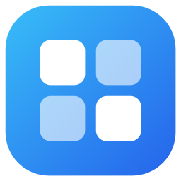

<p align="center">
  
</p>

<h1 align="center">Desko</h1>

<p align="center">
  <b>Sắp xếp desktop Windows gọn gàng với các fence.</b><br>
  Khung kính mờ gom icon theo nhóm, thu gọn, gộp thành tab, tìm nhanh, ẩn/hiện chỉ bằng một cú nhấp đúp.
</p>

<p align="center">
  <a href="https://github.com/doson709/Desko/actions/workflows/build.yml"></a>
  <a href="LICENSE"></a>
  
  
</p>

<p align="center">
  <a href="#cài-đặt-người-dùng">Cài đặt</a> ·
  <a href="#tính-năng">Tính năng</a> ·
  <a href="#phím-tắt">Phím tắt</a> ·
  <a href="#build-từ-mã-nguồn">Build</a>
</p>

*Desko organizes the Windows desktop into fences: frosted panels that group icons, roll up, merge into tabs and hide with a double-click. Windows 10/11, C# / WPF on .NET 8. The interface is in Vietnamese.*

> **File của bạn không bao giờ bị di chuyển hay xóa.** File trong fence vẫn nằm nguyên trên Desktop; Desko chỉ tạm ẩn icon của chúng khỏi desktop để hiển thị trong fence, và trả lại ngay khi ứng dụng thoát, kể cả khi bị tắt đột ngột.

## Tính năng

**Fence**
- Tạo fence bằng cách giữ **chuột phải và kéo một khung** trên vùng trống của desktop.
- Kéo icon vào fence; kéo ra desktop để bỏ khỏi fence (icon về đúng chỗ thả). Thả lên giữa một thư mục trong fence để chuyển file vào thư mục đó.
- **Tab**: kéo một fence thả lên fence khác để gộp; menu chuột phải để thêm, tách hoặc xóa tab.
- **Folder Portal**: fence hiển thị nội dung một thư mục bất kỳ; nhấp đúp thư mục con để duyệt ngay trong fence, Backspace để quay lại. Thư mục hàng nghìn file vẫn mượt (chỉ dựng các icon đang nhìn thấy).
- **Quy tắc tự sắp xếp**: ví dụ ảnh vào fence "Ảnh", PDF vào "Tài liệu"; dọn desktop một lần hoặc tự động cho file mới.
- **Thu gọn** bằng nhấp đúp thanh tiêu đề; rê chuột vào để xem nhanh. **Ẩn / hiện mọi fence** bằng nhấp đúp vùng trống desktop.
- Kéo mép để đổi kích thước: tự **căn vừa số cột/hàng icon**, bắt dính vào mép màn hình, fence khác và lưới.
- Nhớ **bố cục riêng cho từng cấu hình màn hình** (laptop, laptop + màn hình phụ, đổi độ phân giải).

**Làm việc với file**
- Menu chuột phải gốc của Windows (Open with, Send to, 7-Zip, Properties...).
- Đổi tên ngay tại icon (F2 hoặc nhấp chậm), chọn nhiều bằng kéo khung, Delete / Ctrl+C / Ctrl+X / Ctrl+V.
- Gõ chữ trong fence để lọc icon, không cần gõ dấu ("dao tao" tìm được "đào tạo").
- Mọi thao tác file đi qua shell của Windows: hộp thoại trùng tên, Thùng rác và Ctrl+Z của Explorer vẫn dùng được.

**Giao diện**
- Nền kính mờ Acrylic (hoặc Blur / trong suốt), góc bo kiểu Windows 11, theo chế độ sáng/tối và màu nhấn của Windows.
- Icon cùng cỡ với icon desktop; hiệu ứng mượt khi hiện icon, rê chuột, thu gọn/mở fence.
- Cửa sổ Cài đặt áp dụng thay đổi ngay; hướng dẫn lần đầu có thể tạo sẵn các fence gợi ý từ desktop hiện tại.

## Phím tắt

| Phím | Tác dụng |
|---|---|
| `Ctrl` + `Alt` + `F` | Tìm trong mọi fence (Enter mở, Ctrl+Enter chỉ vị trí trong fence) |
| `Ctrl` + `Alt` + `D` | Nhìn trộm: đưa mọi fence lên trên các cửa sổ khác |
| Gõ chữ trong fence | Lọc icon (Esc để xóa) |
| `F2` | Đổi tên tại icon |
| `Ctrl` + `Z` | Hoàn tác thao tác với fence (xóa, gộp, tách tab, chuyển portal...) |
| `Backspace` | Quay lại thư mục trước trong Folder Portal |

## Cài đặt (người dùng)

1. Tải gói **Desko** từ trang [Releases](https://github.com/doson709/Desko/releases) (hoặc artifact `Desko` của [GitHub Actions](https://github.com/doson709/Desko/actions), hoặc tự build) rồi giải nén.
2. Chạy **`setup.bat`**:
   - tự cài **.NET 8 Desktop Runtime** nếu máy chưa có (qua winget, hoặc tải từ Microsoft);
   - cài ứng dụng vào `%LOCALAPPDATA%\Programs\Desko` (không cần quyền admin), tạo shortcut trong menu Start;
   - hỏi có khởi động cùng Windows không, rồi mở ứng dụng.
3. Gỡ cài đặt: chạy `uninstall.bat` trong thư mục cài đặt.

Windows SmartScreen có thể cảnh báo vì ứng dụng chưa được ký số: chọn **More info → Run anyway**.

## Build từ mã nguồn

Yêu cầu: Windows 10/11 x64, [.NET 8 SDK](https://dotnet.microsoft.com/download/dotnet/8.0).

```powershell
.\build.ps1
```

Kết quả nằm trong `dist\`, sẵn sàng nén zip để chia sẻ:

| File | |
|---|---|
| `Desko.exe` | Ứng dụng (cần .NET 8 Desktop Runtime) |
| `DeskoGuard.exe` | Tiến trình canh gác (xem bên dưới) |
| `setup.bat`, `uninstall.bat`, `Huong dan.txt` | Bộ cài và hướng dẫn cho người dùng |

`DeskoGuard` được biên dịch bằng **Native AOT** (khoảng 1–2 MB RAM) nếu máy build có Visual Studio C++ Build Tools và **Windows SDK**; nếu không, `build.ps1` tự build nó dạng .NET thường (khoảng 6 MB RAM). GitHub Actions (`.github/workflows/build.yml`) build bản Native AOT và đính kèm gói `dist` ở mỗi lần push.

## Cách hoạt động

- **Ẩn icon khỏi desktop**: fence thường không chuyển file đi đâu cả. Ứng dụng bật thuộc tính *Hidden* cho file trên Desktop để Explorer không vẽ icon, còn fence hiển thị file đó. Mọi file đã ẩn được ghi vào `HiddenByUs` trong config *trước khi* ẩn.
- **Luôn trả file về**: khi thoát, ứng dụng gỡ ẩn tất cả. Nếu bị tắt đột ngột, `DeskoGuard` (chạy kèm, chờ ứng dụng chính) gỡ ẩn ngay; nếu cả hai cùng chết (mất điện) và ứng dụng không tự khởi động, một lệnh `--restore` được đăng ký chạy lúc đăng nhập.
- **Không để bản copy bị ẩn theo**: Windows chép cả thuộc tính Hidden, nên khi kéo file ra ngoài, copy, cắt hay xóa, ứng dụng tạm gỡ ẩn file trước.
- **Recycle Bin, This PC...** được đưa vào fence dưới dạng shortcut, icon gốc trên desktop được tạm tắt (cùng công tắc với Desktop icon settings).
- **Fence là cửa sổ nằm ở lớp desktop** (owned by `Progman`), không bị Win+D làm ẩn; nền kính mờ do DWM vẽ, nội dung vẽ bằng CPU để tiết kiệm RAM (có thể bật GPU trong Cài đặt).
- **Tự khởi động** bằng tác vụ đăng nhập của Task Scheduler (không bị Windows trì hoãn như khóa Run).

## Dữ liệu và dòng lệnh

| Đường dẫn | Nội dung |
|---|---|
| `%APPDATA%\Desko\config.json` | Fence, tab, quy tắc, bố cục theo màn hình, cài đặt |
| `%APPDATA%\Desko\error.log` | Lỗi (tự xoay vòng khi quá 1 MB) |
| `%LOCALAPPDATA%\Desko\iconcache\` | Icon đã dựng sẵn, giúp mở máy là icon hiện ngay |

| Lệnh | Tác dụng |
|---|---|
| `Desko.exe` | Chạy; nếu đang chạy rồi thì mở Cài đặt |
| `Desko.exe --welcome` | Mở hướng dẫn lần đầu |
| `Desko.exe --exit` | Yêu cầu bản đang chạy thoát bình thường (trả file về desktop) |
| `Desko.exe --autostart on\|off` | Bật / tắt khởi động cùng Windows |
| `Desko.exe --restore` | Gỡ ẩn mọi file nếu ứng dụng không chạy |
| `Desko.exe --uninstall` | Thoát, trả file về, bỏ khởi động cùng Windows (dùng bởi `uninstall.bat`) |

## Cấu trúc mã nguồn

```
App.xaml(.cs), Program.cs   Khởi động, các chế độ dòng lệnh, một phiên bản duy nhất
Core/        FenceManager (fence, tab, ẩn/hiện, quy tắc, hoàn tác), DesktopHook (chuột trên desktop),
             Recovery (canh gác, khôi phục), AutoStart, DisplayLayouts, Snapper, Rules
Shell/       Icon và cache, menu chuột phải của Windows, kéo thả kiểu Explorer, thao tác file,
             đặt vị trí icon desktop, mục ảo (Recycle Bin...)
UI/          FenceWindow, Cài đặt, Hướng dẫn, Tìm kiếm, Nhìn trộm, khay hệ thống, giao diện theo theme
Interop/     Khai báo Win32
Guard/       DeskoGuard: tiến trình canh gác Native AOT
installer/   setup.bat, uninstall.bat, hướng dẫn cho người dùng
```

## Hạn chế đã biết

- Nếu bật **Show hidden items** trong Explorer, file trong fence sẽ hiện mờ trên desktop.
- Sau khi **Ctrl+C** một file trong fence, icon của nó hiện tạm trên desktop cho đến khi bạn copy thứ khác (để bản dán không bị ẩn).
- Kéo khung chọn từ desktop không chọn được icon nằm trong fence.
- Góc bo do ứng dụng tự cắt (để bỏ bóng đổ của Windows 11) không được khử răng cưa.
- Một số phần mềm diệt virus có thể nghi ngờ vì ứng dụng theo dõi chuột trên desktop và đổi thuộc tính file.

## Giấy phép

[MIT](LICENSE). Desko là dự án độc lập, không liên quan đến Stardock hay sản phẩm Fences® của họ.
